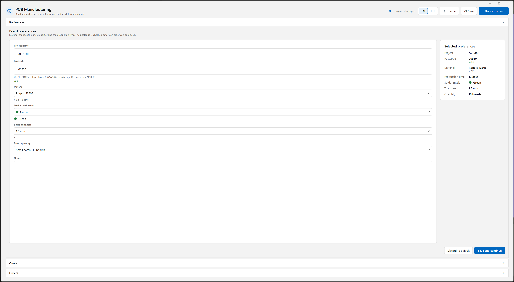
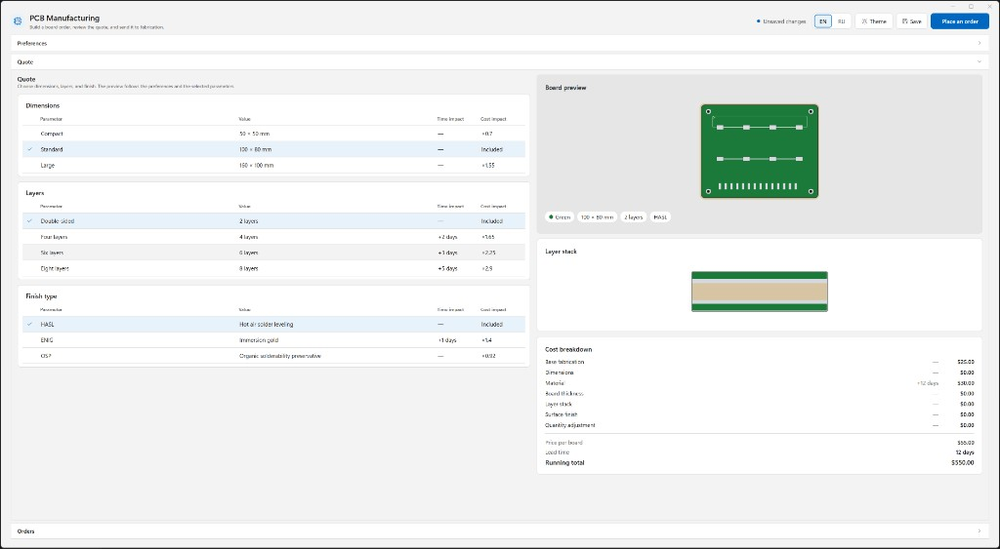
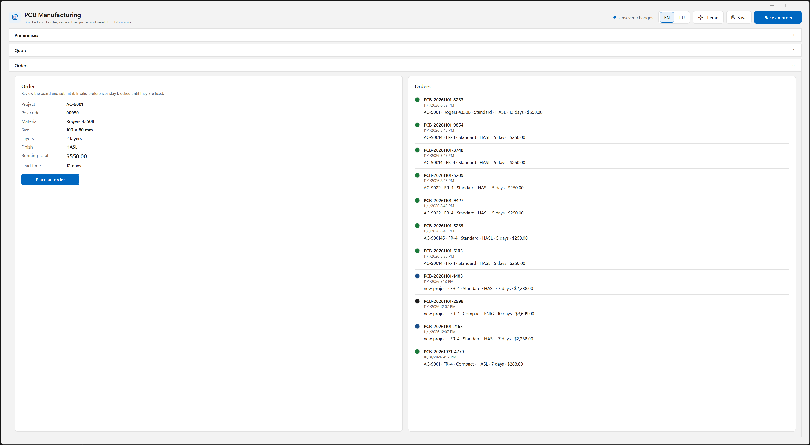
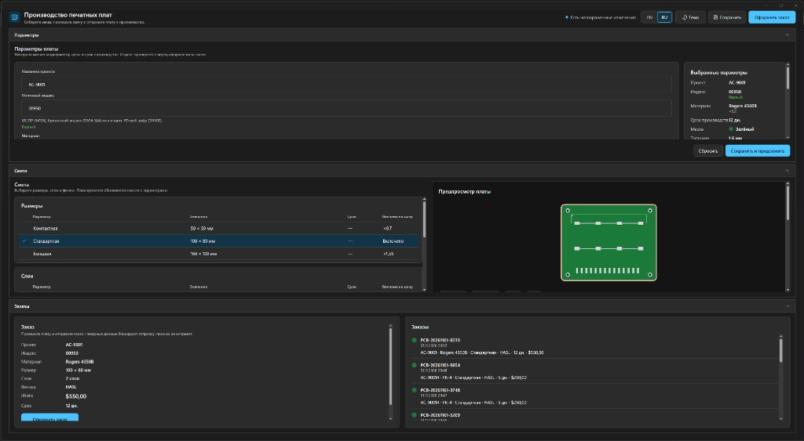

# PCB Manufacturing

Desktop app for building a PCB quote and placing an order. The same view models drive a Windows 11-style WPF client and an Avalonia desktop client.

## Requirements

- .NET SDK 10 (this repo pins `10.0.402` in `global.json`, with `latestFeature` roll-forward)
- Windows, for the WPF client
- Windows was the platform used to run the Avalonia client. The Avalonia project targets `net10.0` and can be built on other desktops that Avalonia supports

## Run

```powershell
dotnet test PCBManufacturing.slnx
dotnet run --project src/PCBManufacturing.Wpf
dotnet run --project src/PCBManufacturing.Avalonia
```

Both apps read and write the same files under `%AppData%\PCBManufacturing`:

- `preferences.json` — board choices, theme, and language
- `orders.json` — the latest 50 orders

Catalog options and English/Russian strings ship as JSON next to the app (`catalog.json`, `Localization/en.json`, `Localization/ru.json`).

## Layout

| Project | Role |
| --- | --- |
| `PCBManufacturing.Core` | Models, JSON catalog, pricing, postcode rules, artwork geometry, localization, preferences, and order history. No UI toolkit. |
| `PCBManufacturing.PresentationLogic` | Shared MVVM surface (`CommunityToolkit.Mvvm`): preferences, quote, order, and the shell. |
| `PCBManufacturing.Wpf` | Windows desktop UI. Custom control templates, light/dark palettes, vector icons. |
| `PCBManufacturing.Avalonia` | Windows desktop UI on Avalonia 12 Fluent theme, with ReactiveUI activation and data templates that map each view model to a view. |
| `tests/*` | xUnit project for each of the four projects above. |

`Microsoft.Extensions.Hosting` composes the same service graph in both apps. Dialogs and theme changes go through `IDialogService` and `IThemeApplier`, implemented per toolkit.

## What the screen does

One window, three tabs:

- **Preferences** — project name (default `AC-9001`), postcode, material, solder mask, thickness, quantity, and notes. The summary updates with the selection. An empty or invalid postcode is marked on the field. US ZIP, UK postcode, and a 6-digit Russian index are accepted.

  

- **Quote** — dimensions, layers, and finish, each with time and cost impact. The vector board drawing and layer stack follow the current choices. The default board (FR-4, 1.6 mm, 100×80 mm, 2 layers, HASL, quantity 10) is $25.00 each, $250.00 total, 5 days.

  

- **Order** — review, then place the order. Invalid input opens a warning. A valid order asks for confirmation, waits briefly, and is stored in the history.

  

The header switches English/Russian and light/dark, saves the current choices, and can place the order from any tab. Discard resets the board fields and keeps the theme and language.



## Tests

`dotnet test` covers catalog loading, the price and lead-time calculation, postcode cases, localization key parity, preference and order persistence, artwork paths, view-model flows (including the order dialog), WPF geometry and theme dictionaries, and Avalonia geometry plus the Fluent brushes the shell uses.
